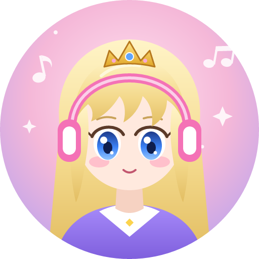

<div align="center">



# Milaine Bot

**A Discord music bot written in Rust that plays YouTube audio in your voice channel.**

Slash commands · search autocomplete · queue with history · auto-disconnect when idle · English & Spanish


</div>

---

> 🚧 **Work in progress.** See [ROADMAP.md](ROADMAP.md) for what is done and what is next.

## Features

- 🎵 `/play` a song by **name** (with live autocomplete suggestions) or by **YouTube link**
- 📜 Queue with history: skip forward, go back, replay the current track
- ⏯️ Pause / resume / stop / disconnect
- 🔊 Joins the voice channel of whoever runs `/play`
- 💤 Goes idle when the queue ends and **leaves after 10 minutes** without music (or 2 minutes alone)
- 🌎 Replies in **English or Spanish** based on each user's Discord language
- 🏠 Works in many servers at once, each with its own queue

## Commands

| Command | Description |
| --- | --- |
| `/play <query or url>` | Play a song now, or add it to the queue if something is playing. Autocompletes as you type. |
| `/pause` | Pause or resume the current song. |
| `/resume` | Resume playback. |
| `/stop` | Stop playback and clear the queue (the bot stays in the channel). |
| `/disconnect` | Leave the voice channel and clear the queue. |
| `/next` | Skip to the next song. |
| `/prev` | Go back to the previous song. |
| `/replay` | Restart the current song from the beginning. |
| `/queue` | Show the current song and what is coming next. |
| `/ping` | Check that the bot is alive. |

## Getting started (local)

### 1. Prerequisites

| Tool | Why | Install |
| --- | --- | --- |
| [Rust](https://rustup.rs) 1.85+ | Build the bot | `rustup` |
| [yt-dlp](https://github.com/yt-dlp/yt-dlp) | Extract audio from YouTube | Windows: `winget install yt-dlp.yt-dlp` · macOS: `brew install yt-dlp` · Linux: `pipx install yt-dlp` or your package manager |
| [ffmpeg](https://ffmpeg.org) | Audio transcoding | Windows: `winget install Gyan.FFmpeg` · macOS: `brew install ffmpeg` · Linux: `apt install ffmpeg` |
| CMake + C compiler | Builds the bundled Opus codec | Usually already present with a Rust toolchain; Windows: Visual Studio Build Tools + `winget install Kitware.CMake` |

Check both binaries are on your `PATH`:

```sh
yt-dlp --version
ffmpeg -version
```

> 💡 Keep yt-dlp up to date (`yt-dlp -U` or your package manager). YouTube changes often and old versions break.

### 2. Create the Discord application

1. Go to the [Discord Developer Portal](https://discord.com/developers/applications) → **New Application** → name it *Milaine*.
2. **General Information** → upload `assets/logo.png` as the app icon.
3. **Bot** → upload `assets/logo.png` as the avatar → **Reset Token** and copy it (you'll need it in step 3).
   No privileged intents are required.
4. **OAuth2 → URL Generator**:
   - Scopes: `bot`, `applications.commands`
   - Bot permissions: View Channels, Send Messages, Embed Links, Connect, Speak, Use Voice Activity
5. Open the generated URL and add the bot to your server. Or use this one, replacing `YOUR_CLIENT_ID`:

   ```
   https://discord.com/oauth2/authorize?client_id=YOUR_CLIENT_ID&scope=bot+applications.commands&permissions=36719616
   ```

### 3. Configure

```sh
git clone https://github.com/<your-github-user>/milaine-bot.git
cd milaine-bot
cp .env.example .env
```

Edit `.env`:

```env
DISCORD_TOKEN=your-bot-token
DEV_GUILD_ID=your-test-server-id   # optional, makes commands appear instantly
```

> To get a server ID: Discord → User Settings → Advanced → enable **Developer Mode**, then right-click your server → **Copy Server ID**.

| Variable | Required | Default | Description |
| --- | --- | --- | --- |
| `DISCORD_TOKEN` | ✅ | — | Bot token |
| `DEV_GUILD_ID` | | — | Register commands only in this server (instant). Empty = global (up to 1 h to appear) |
| `YOUTUBE_API_KEY` | | — | Use YouTube Data API v3 for autocomplete instead of the public suggestion endpoint |
| `IDLE_TIMEOUT_SECS` | | `600` | Leave the channel after this many seconds with nothing playing |
| `ALONE_TIMEOUT_SECS` | | `120` | Leave the channel after this many seconds alone |
| `YTDLP_COOKIES` | | — | Path to a cookies file for yt-dlp (needed on some servers) |
| `RUST_LOG` | | `info,milaine_bot=debug` | Log level |

### 4. Run

```sh
cargo run --release
```

You should see `connected to Discord` and `registered commands`. Join a voice channel and type `/play`.

## Running in production

> 🚧 Planned in [M8](ROADMAP.md#m8--production-later-). Docker image, docker-compose and a systemd unit will land here.

Things to know already:

- The host needs `yt-dlp` and `ffmpeg` installed and up to date.
- YouTube often blocks datacenter IPs. If playback fails with "Sign in to confirm you're not a bot",
  export cookies from a logged-in browser to a file and set `YTDLP_COOKIES=/path/to/cookies.txt`.
- Leave `DEV_GUILD_ID` empty so commands are registered globally.

## Development

```sh
cargo test                               # unit tests
cargo clippy --all-targets -- -D warnings
cargo fmt
```

Project layout:

```
src/
├── main.rs        # bootstrap: config, framework, songbird, command registration
├── config.rs      # env configuration
├── http.rs        # shared HTTP client (neutral User-Agent)
├── i18n.rs        # English / Spanish replies
├── state.rs       # shared bot state (Data)
└── commands/      # slash commands
assets/            # logo (SVG source + PNG)
docs/DECISIONS.md  # design decisions
ROADMAP.md         # requirements and progress
```

The logo is drawn in `assets/logo.svg`. Re-export it with [resvg](https://github.com/linebender/resvg):

```sh
cargo install resvg
resvg -w 512 -h 512 assets/logo.svg assets/logo.png
```

## Disclaimer

This project is for personal and educational use. Streaming content from YouTube may be subject to
[YouTube's Terms of Service](https://www.youtube.com/t/terms); you are responsible for how you use it.
The logo is an original character and is not affiliated with any existing franchise.

## License

[MIT](LICENSE)
